<p align="center">
  
</p>

<p align="center">
  <a href="https://github.com/ishandutta2007/Awesome-Awesome-Awesome"></a><a href="https://discord.gg/jc4xtF58Ve"></a>
  <a href="https://github.com/ishandutta2007/Awesome-Advanced-Spreadsheet/stargazers"></a>
  <a href="https://github.com/ishandutta2007/Awesome-Advanced-Spreadsheet/network/members"></a>
  <a href="https://github.com/ishandutta2007/Awesome-Advanced-Spreadsheet/blob/main/LICENSE"></a>
  <a href="https://github.com/ishandutta2007/Awesome-Advanced-Spreadsheet/pulls"></a>
  <a href="https://github.com/ishandutta2007"></a>
</p>

# 📊 Awesome Advanced Spreadsheet

> **Curated landscape of modern SaaS spreadsheet platforms, relational spreadsheet-database hybrids, headless calculation engines, and self-hosted open-source alternatives.**  
> *Engineered for operations architects, data analysts, engineers, and builders developing programmable data workflows, custom internal tools, and reactive grid applications.*

---

## 📑 Table of Contents

- [🎯 Overview & Architecture](#-overview--architecture)
- [📈 Sector Overview & Market Dynamics](#-sector-overview--market-dynamics)
- [🏢 SaaS & Hosted Commercial Platforms](#-saas--hosted-commercial-platforms)
- [🔓 Open-Source GitHub Projects](#-open-source-github-projects)
- [🧩 Frameworks for Building Custom Spreadsheets](#-frameworks-for-building-custom-spreadsheets)
- [🤝 How to Contribute](#-how-to-contribute)
- [📈 Star History](#-star-history)
- [💖 Support & Sponsoring](#-support--sponsoring)
- [⚖️ Disclaimer](#-disclaimer)

---

## 🎯 Overview & Architecture

Traditional spreadsheets operate on rigid cell grids with localized formulas. **Advanced Spreadsheets** represent a paradigm shift by merging the intuitive spatial flexibility of a spreadsheet with:
- 🔗 **Relational Data Modeling**: Foreign key links, schema validation, and multi-table integrity.
- 🐍 **Programmable Computation**: Native Python execution, live SQL querying, and JavaScript/TypeScript extensions.
- ⚡ **No-Code Automations & APIs**: Webhook triggers, scheduled syncs, automated workflows, and auto-generated REST/GraphQL endpoints.
- 🤖 **AI-Native Augmentation**: Cell-level prompt chaining, LLM evaluation, and automated enrichment.
- 🌐 **Deployment Sovereignty**: Choice between managed multi-tenant SaaS clouds and air-gapped, self-hosted open-source stacks.

---

## 📈 Sector Overview & Market Dynamics

The global collaborative spreadsheet, work management, and no-code database software sector represents an estimated **$12B to $16B+ annual market**, projected to surpass **$45B by 2030** with an expected CAGR of **14.2%**.

From a structural perspective, the sector exhibits a **barbell concentration profile**:
- **Core Productivity Foundation (Highly Concentrated / Near-Duopoly)**: Foundational grid software is dominated by Microsoft Excel and Google Sheets, holding over 85% worldwide office productivity volume in a classic "winner-take-most" distribution.
- **Advanced Programmable & Relational Layer (Moderately Fragmented)**: The frontier of modern spreadsheet-database hybrids (Airtable, Smartsheet, Coda), AI data-enrichment workbooks (Clay), and technical finance/analytics canvases (Equals, Quadratic) remains moderately fragmented. Rather than a single winner-take-all outcome, specialized platforms capture distinct domain workflows (e.g., GTM operations, finance analytics, product portfolio tracking), while open-source self-hosted solutions (NocoDB, Teable, Grist, Baserow) rapidly expand to serve privacy-sensitive and compliance-regulated enterprise environments.

---

## 🏢 SaaS & Hosted Commercial Platforms

The following table evaluates the leading commercial SaaS advanced spreadsheet platforms, ranked in descending order by **Company Size (Revenue / Market Capitalization / Valuation)**.

| 🏢 Product | 💰 Valuation / Company Size | 💵 Starting Tier Pricing | 🎁 Free Tier / Trial Limits | ✨ Key Capabilities & Focus |
| :--- | :--- | :--- | :--- | :--- |
| **[Microsoft Excel](https://www.microsoft.com/microsoft-365/excel)** | **~$3.1 Trillion** market cap (Microsoft Corp.) / **~$245B+** annual revenue | **$6.00 / user / month** (Microsoft 365 Business Basic, annual commitment) or **$6.99 / month** (Personal) | **Free forever web edition** (Excel for the Web at Office.com) with **5 GB** cloud storage via personal Microsoft Account; or **30-day free trial** of Microsoft 365 Family/Business with desktop suite | Industry-standard grid featuring Power Query, Power Pivot, dynamic arrays, enterprise Python integration, Copilot AI, and VBA automation. |
| **[Google Sheets](https://workspace.google.com/products/sheets/)** | **~$2.1 Trillion** market cap (Alphabet Inc.) / **~$350B+** annual revenue | **$6.00 / user / month** (Google Workspace Business Starter, annual) or **$7.20 / month** flexible | **Free forever plan** for personal Google accounts with **15 GB** shared cloud storage, up to **10 million cells** (or 18,278 columns) per workbook, and full Google Apps Script access | Cloud-native multi-user real-time collaboration, web connectors, massive third-party add-on marketplace, and serverless Apps Script workflows. |
| **[Airtable](https://www.airtable.com/)** | **$11.7 Billion** valuation (Series F) / **~$300M+** ARR | **$20.00 / seat / month** (Team tier, billed annually) or **$24.00 / seat / month** (billed monthly) | **Free forever plan**: Unlimited bases, up to **1,000 records per base**, **1 GB attachment** storage per base, up to **5 editors**, and 100 automation runs/month | Flagship spreadsheet-database hybrid with relational records, multi-layout views (Kanban, Calendar, Gallery, Gantt, Form), and low-code workflow automations. |
| **[Smartsheet](https://www.smartsheet.com/)** | **$8.4 Billion** valuation (Blackstone & Vista Equity acquisition) / **~$1.0B+** ARR | **$9.00 / user / month** (Pro tier, billed annually; max 10 users) or **$12.00 / user / month** (monthly) | **30-day free trial** with full enterprise features (unlimited sheets & automations); Free plan supports **1 user**, **2 sheets**, up to **500 MB** storage, and 2 viewers | Enterprise-grade portfolio and work management with interactive Gantt schedules, resource allocation, and cross-sheet rollup automations. |
| **[Coda](https://coda.io/)** | **$1.4 Billion** valuation (Series D) / **~$50M+** ARR | **$10.00 / Doc Maker / month** (Pro tier, billed annually) or **$12.00 / month** (monthly); editors/viewers free | **Free forever plan**: Unlimited unshared and shared docs, document size capped at **50 objects** (tables, views, pages) and **1,000 rows per doc**, with 35 automation runs/month | Blends documents, relational databases, and interactive UI buttons into custom team operating software; extensive "Packs" integration system. |
| **[Clay](https://clay.com/)** | **$1.3 Billion** valuation (2024 Series B) / **~$30M+** ARR | **$149.00 / month** (Starter plan; $134/mo billed annually) with 2,000 credits/month included | **14-day free trial** of Pro plan; **Free forever plan** with **100 credits / month**, 1 user seat, and access to 100+ native data enrichment providers | AI-powered data enrichment and GTM outreach spreadsheet chaining 100+ public and proprietary data sources into outbound sales pipelines. |
| **[Equals](https://equals.com/)** | **~$100+ Million** valuation ($89M total venture funding raised) | **$29.00 / editor / month** (Starter plan, billed annually) or **$39.00 / month** (monthly); free viewers | **14-day free trial** with complete access to live SQL warehouse querying, scheduled automated runs, connected sheets, and unlimited dashboards | Modern finance and analytics spreadsheet featuring native SQL and Python execution directly inside cells, live database connectors, and git-like versioning. |
| **[Rows](https://rows.com/)** | **~$25 Million** total venture funding (Accel & Lakestar) | **$10.00 / member / month** (Plus plan, billed annually; $20/mo minimum) or workspace plan at **$59.00 / month** | **Free forever plan**: Unlimited spreadsheets, up to **3 workspace members**, **10,000 integration actions / month**, and 50+ built-in API data connections | Spreadsheet engineered with native REST API integrations, OpenAI-backed formula copilot, and embeddable live web charts and calculators. |
| **[GRID](https://grid.is/)** | **~$20 Million** total venture funding | **$29.00 / author / month** (Starter plan, billed annually) or **$35.00 / month** (monthly) | **Free forever plan**: Up to **3 active interactive documents**, 1 author seat, and **100 views / month** with formula-driven interactive widgets | Publishing engine that transforms existing Excel and Google Sheets models into interactive, branded web applications without exposing raw formulas. |
| **[Quadratic](https://quadratichq.com/)** | **~$5.6 Million** seed funding | **$15.00 / user / month** (Pro tier, billed annually) or **$20.00 / user / month** (monthly) | **Free forever plan**: Unlimited public sheets, up to **3 private files**, 1 editor, unlimited viewers, and standard cloud compute limits for Python and SQL | Infinite canvas spreadsheet merging Python (Pandas/NumPy), SQL, and formulas in one reactive, zoomable data science workspace. |

---

## 🔓 Open-Source GitHub Projects

Curated collection of self-hosted, open-source spreadsheet engines, relational database alternatives, and headless calculation runtimes.  
**Ranked in descending order by GitHub Stars ⭐.**

---

### 1. 🏆 [AppFlowy](https://github.com/AppFlowy-IO/AppFlowy) [](https://github.com/AppFlowy-IO/AppFlowy/stargazers)
- **License**: AGPL-3.0 | **Primary Tech**: Flutter, Rust, SQLite
- **Description**: Open-source collaborative workspace and Notion/Airtable alternative. Features high-performance grid tables, relational views, Kanban boards, offline-first sync, and local AI agent integration without vendor data lock-in.

---

### 2. 🏆 [NocoDB](https://github.com/nocodb/nocodb) [](https://github.com/nocodb/nocodb/stargazers)
- **License**: AGPL-3.0 | **Primary Tech**: Node.js, Vue.js, PostgreSQL / MySQL / SQLite
- **Description**: Open-source Airtable alternative that transforms any existing relational database into a smart spreadsheet. Provides Grid, Gallery, Kanban, and Form views, role-based access control, and auto-generated REST/GraphQL APIs capable of handling millions of rows.

---

### 3. 🏆 [SheetJS](https://github.com/SheetJS/sheetjs) [](https://github.com/SheetJS/sheetjs/stargazers)
- **License**: Apache-2.0 | **Primary Tech**: JavaScript / TypeScript
- **Description**: The industry-standard spreadsheet data toolkit. Powers parsing, manipulation, and generation of Excel (XLSX, XLS), ODS, CSV, and dozens of tabular formats across browsers, Node.js, and edge runtimes.

---

### 4. 🏆 [Univer](https://github.com/dream-num/univer) [](https://github.com/dream-num/univer/stargazers)
- **License**: Apache-2.0 | **Primary Tech**: TypeScript, Canvas, WebGL
- **Description**: Next-generation full-stack enterprise office harness and canvas engine for Spreadsheets, Docs, and Slides. Designed for AI agents and collaborative enterprise web apps, featuring high-performance canvas rendering and rich formula support.

---

### 5. 🏆 [Handsontable](https://github.com/handsontable/handsontable) [](https://github.com/handsontable/handsontable/stargazers)
- **License**: Commercial / Free Evaluation | **Primary Tech**: JavaScript, TypeScript, React, Angular, Vue
- **Description**: Enterprise JavaScript data grid with a spreadsheet look and feel. Offers Excel-grade data editing, formula calculations, cell validation, sorting, filtering, and seamless integration with major modern frontend frameworks.

---

### 6. 🏆 [Teable](https://github.com/teableio/teable) [](https://github.com/teableio/teable/stargazers)
- **License**: AGPL-3.0 | **Primary Tech**: TypeScript, Next.js, PostgreSQL
- **Description**: Super-fast, real-time AI-native spreadsheet built directly on native PostgreSQL. Acts as a zero-lag Airtable alternative supporting massive datasets (millions of records), SQL queries, real-time collaboration, and automatic schema reflection.

---

### 7. 🏆 [Luckysheet](https://github.com/dream-num/Luckysheet) [](https://github.com/dream-num/Luckysheet/stargazers)
- **License**: MIT | **Primary Tech**: JavaScript, Canvas
- **Description**: Feature-rich online JavaScript spreadsheet library with comprehensive Excel-compatible formatting, pivot tables, chart rendering, matrix calculations, and real-time collaboration features (upgraded lineage lives in Univer).

---

### 8. 🏆 [x-spreadsheet](https://github.com/myliang/x-spreadsheet) [](https://github.com/myliang/x-spreadsheet/stargazers)
- **License**: MIT | **Primary Tech**: JavaScript, HTML5 Canvas
- **Description**: Ultra-lightweight, zero-dependency canvas-based web spreadsheet library. Designed for developers seeking an embeddable, fast-loading, customizable spreadsheet UI in web applications.

---

### 9. 🏆 [Grist](https://github.com/gristlabs/grist-core) [](https://github.com/gristlabs/grist-core/stargazers)
- **License**: Apache-2.0 | **Primary Tech**: Python, JavaScript, SQLite
- **Description**: Modern relational spreadsheet combining the ease of spreadsheets with genuine relational database integrity. Supports standard Python expressions in formulas, granular column- and row-level access control (RBAC), and portable SQLite storage.

---

### 10. 🏆 [Baserow](https://github.com/baserow/baserow) [](https://github.com/baserow/baserow/stargazers)
- **License**: MIT | **Primary Tech**: Python, Django, Nuxt.js, PostgreSQL
- **Description**: Open-source modular no-code database and Airtable alternative. Offers infinite scalability, AI assistant integrations (Kuma), real-time collaboration, webhooks, REST APIs, and enterprise compliance (GDPR, HIPAA, SOC 2 Type II).

---

### 11. 🏆 [Mathesar](https://github.com/mathesar-foundation/mathesar) [](https://github.com/mathesar-foundation/mathesar/stargazers)
- **License**: GPL-3.0 | **Primary Tech**: Python, Svelte, PostgreSQL
- **Description**: Intuitive spreadsheet-like interface built natively on PostgreSQL. Enables technical and non-technical teams to view, edit, query, and collaborate on PostgreSQL schemas without abstractions, preserving native data types and constraints.

---

### 12. 🏆 [LibreOffice Calc](https://github.com/LibreOffice/core) [](https://github.com/LibreOffice/core/stargazers)
- **License**: MPL-2.0 | **Primary Tech**: C++, LibreOffice Ecosystem
- **Description**: The benchmark open-source desktop spreadsheet for Linux, Windows, and macOS. Offers comprehensive XLSX/ODS compatibility, comprehensive formula engines, pivot tables, data piloting, and extensive macro support.

---

### 13. 🏆 [IronCalc](https://github.com/ironcalc/IronCalc) [](https://github.com/ironcalc/IronCalc/stargazers)
- **License**: Apache-2.0 / MIT | **Primary Tech**: Rust, WebAssembly, Python, JavaScript
- **Description**: High-performance, memory-safe modern spreadsheet calculation engine written entirely in Rust. Features WASM compilation for browser execution, headless server calculations, and Python bindings.

---

### 14. 🏆 [FortuneSheet](https://github.com/ruilisi/fortune-sheet) [](https://github.com/ruilisi/fortune-sheet/stargazers)
- **License**: MIT | **Primary Tech**: TypeScript, React
- **Description**: Drop-in JavaScript/React spreadsheet component designed to provide out-of-the-box Excel and Google Sheets feature parity with clean component lifecycle integration.

---

### 15. 🏆 [Collabora Online Calc](https://github.com/CollaboraOnline/online) [](https://github.com/CollaboraOnline/online/stargazers)
- **License**: MPL-2.0 | **Primary Tech**: C++, JavaScript
- **Description**: Scalable, cloud-native office suite delivering collaborative web-based editing for LibreOffice Calc workbooks. Ideal for integration into ownCloud, Nextcloud, and custom enterprise cloud storage.

---

### 16. 🏆 [Worklenz](https://github.com/Worklenz/worklenz) [](https://github.com/Worklenz/worklenz/stargazers)
- **License**: AGPL-3.0 | **Primary Tech**: Node.js, Angular, PostgreSQL
- **Description**: Collaborative project and work management platform featuring a spreadsheet-style task tracker, extended Kanban boards, recurring tasks, and granular custom field configurations.

---

### 17. 🏆 [ONLYOFFICE Community Server](https://github.com/ONLYOFFICE/CommunityServer) [](https://github.com/ONLYOFFICE/CommunityServer/stargazers)
- **License**: AGPL-3.0 | **Primary Tech**: C#, TypeScript, JavaScript
- **Description**: Enterprise productivity platform featuring advanced online spreadsheet editors with high Microsoft Office (XLSX) format compatibility, real-time co-authoring, and plugin architecture.

---

### 18. 🏆 [EtherCalc](https://github.com/audreyt/ethercalc) [](https://github.com/audreyt/ethercalc/stargazers)
- **License**: CPAL-1.0 | **Primary Tech**: Node.js, Redis, SocialCalc
- **Description**: Lightweight web spreadsheet for real-time collaborative multi-user editing. Built as a scalable Node.js port of SocialCalc with simple REST API integrations.

---

### 19. 🏆 [HyperFormula](https://github.com/handsontable/hyperformula) [](https://github.com/handsontable/hyperformula/stargazers)
- **License**: GPL-3.0 / Commercial | **Primary Tech**: TypeScript
- **Description**: Fast, headless calculation engine built for business web applications. Includes over 400 formulas, calculation dependency trees, CRUD operations, undo-redo stacks, and sorting mechanisms.

---

### 20. 🏆 [Apache OpenOffice Calc](https://github.com/apache/openoffice) [](https://github.com/apache/openoffice/stargazers)
- **License**: Apache-2.0 | **Primary Tech**: C++, Java
- **Description**: The historic open-source desktop spreadsheet started as StarOffice. Offers classic spreadsheet calculation, charting, and macro capabilities for standard desktop computing.

---

### 21. 🏆 [JamAIBase](https://github.com/EmbeddedLLM/JamAIBase) [](https://github.com/EmbeddedLLM/JamAIBase/stargazers)
- **License**: Apache-2.0 | **Primary Tech**: Python, TypeScript
- **Description**: AI-native collaborative spreadsheet platform. Enables users to chain spreadsheet cells into generative AI pipelines, experiment with prompt models, and benchmark LLM responses in real-time.

---

### 22. 🏆 [Gnumeric](https://github.com/GNOME/gnumeric) [](https://github.com/GNOME/gnumeric/stargazers)
- **License**: GPL-2.0 | **Primary Tech**: C, GTK
- **Description**: High-precision mathematical and statistical spreadsheet developed under the GNOME project, renowned for numerical accuracy, low resource footprint, and advanced analytical functions.

---

### 23. 🏆 [SimpleSpread](https://github.com/baudehlo/SimpleSpread) [](https://github.com/baudehlo/SimpleSpread/stargazers)
- **License**: MIT | **Primary Tech**: Swift
- **Description**: Native macOS spreadsheet application built entirely in Swift. Features native XLSX support, a 157-function formula engine, and swift launch benchmarks exceeding Apple Numbers.

---

### 💡 Honorary Mention: [pyspread](https://gitlab.com/pyspread/pyspread)
- **License**: GPL-3.0 | **Primary Tech**: Python, PyQt
- **Description**: Non-traditional spreadsheet running directly on Python expressions. Every cell returns a first-class Python object (NumPy arrays, lists, dicts, custom classes), making it the most Pythonic standalone grid tool available.

---

## 🧩 Frameworks for Building Custom Spreadsheets

Architects and developers can compose a customized, self-hosted, enterprise-grade advanced spreadsheet platform using modern modular open-source components:

```
┌─────────────────────────────────────────────────────────────┐
│                       Frontend UI Canvas                    │
│      Univer  •  Handsontable  •  x-spreadsheet  •  Fortune   │
└──────────────────────────────┬──────────────────────────────┘
                               │
┌──────────────────────────────▼──────────────────────────────┐
│                    Formula & Calc Engine                    │
│          HyperFormula (TS)  •  IronCalc (Rust / WASM)        │
└──────────────────────────────┬──────────────────────────────┘
                               │
┌──────────────────────────────▼──────────────────────────────┐
│                  Relational & Storage Core                  │
│       Teable  •  Grist  •  Baserow  •  PostgreSQL / SQLite   │
└──────────────────────────────┬──────────────────────────────┘
                               │
┌──────────────────────────────▼──────────────────────────────┐
│                   File & Interop Utilities                  │
│           SheetJS (XLSX, CSV, ODS parse and export)         │
└─────────────────────────────────────────────────────────────┘
```

1. **Frontend Presentation & Grid Rendering**: Embed **Univer** or **Handsontable** for complex canvas interactions, or **x-spreadsheet** for a zero-dependency footprint.
2. **Headless Calculation Engine**: Integrate **HyperFormula** or **IronCalc** to evaluate formulas, dependency DAGs, and cell computations client-side or in serverless runtimes.
3. **Relational Backend & APIs**: Deploy **Teable**, **Grist**, or **Baserow** over **PostgreSQL** or **SQLite** for robust relational tables, RBAC permissions, and auto-generated REST/GraphQL endpoints.
4. **Data Interoperability**: Leverage **SheetJS** for reading, writing, and transforming legacy Excel and CSV assets into clean relational schemas.

---

## 🤝 How to Contribute

Contributions from builders, researchers, and maintainers are enthusiastically welcomed!

1. 🍴 **Fork the repository** on GitHub.
2. 🌿 **Create a new branch** (`git checkout -b feature/add-spreadsheet-tool`).
3. ✍️ **Add or edit entries** in `README.md` following the established structure:
   - For SaaS tools: include verified pricing tier, free tier/trial limits, company size/valuation, and key differentiators.
   - For Open-Source tools: include official repo link, star badge (`style=social&color=white` linking to stargazers), license, tech stack, and concise description.
4. 🚀 **Submit a Pull Request** with a brief summary explaining the addition.

---

## 📈 Star History

[](https://star-history.dera.page/#ishandutta2007/Awesome-Advanced-Spreadsheet&type=date&legend=top-left)

---

## 💖 Support & Sponsoring

Thank you for exploring and utilizing **Awesome Advanced Spreadsheet**! 🌟

If you find this curated directory helpful for your team, research, or personal projects, please consider supporting the project:
- ⭐ **Star this repository** on GitHub to help others discover it.
- 🍴 **Fork and contribute** by submitting new tools or updates.
- 📢 **Share** this list with colleagues, engineering leads, data teams, and founders.
- ☕ **Buy a coffee & sponsor** ongoing maintenance via the [GitHub Sponsors Dashboard](https://github.com/sponsors/ishandutta2007).

<p align="center">
  <a href="https://github.com/sponsors/ishandutta2007">
    
  </a>
</p>

---

## ⚖️ Disclaimer

- This directory is a **community-curated index** created for educational, architectural, and analytical reference. Listings do not constitute commercial endorsement.
- All trademarks, logos, and brand names are the property of their respective owners.
- When self-hosting open-source database solutions in production environments, maintain appropriate backup regimens, network isolation, and regulatory compliance (GDPR, HIPAA, SOC 2).

---

<p align="center">
  <sub>Maintained with ❤️ for the global data, developer, and operations community.</sub>
</p>
